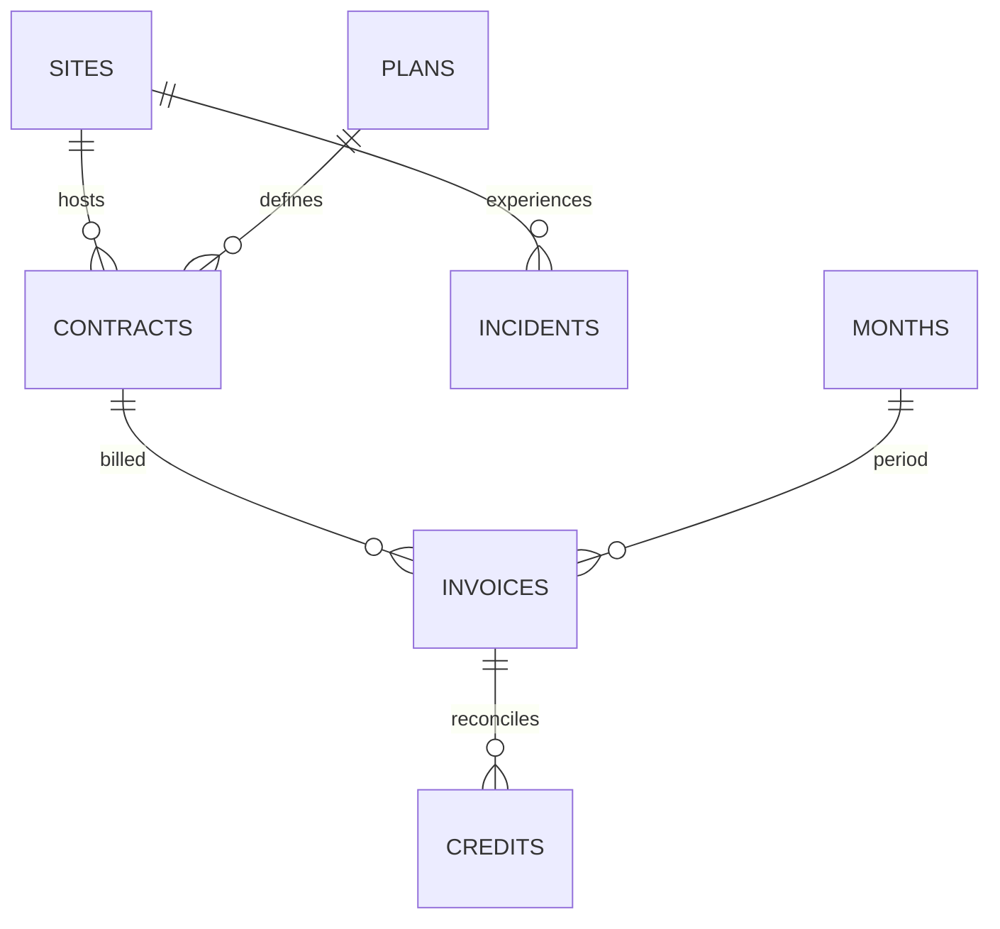
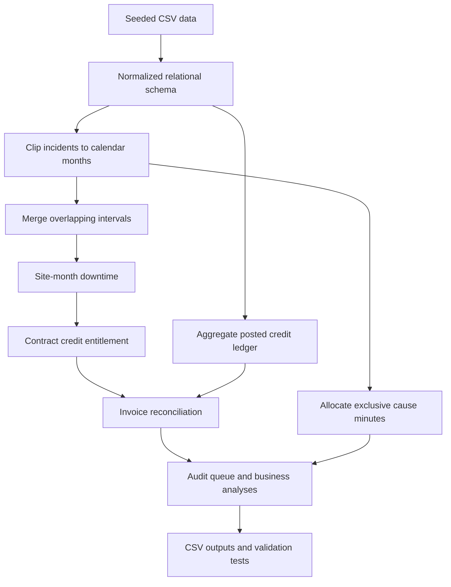

# SignalLedger
### Telecom revenue assurance & network outage analytics

An end-to-end SQL case study for a fictional Indian B2B connectivity provider. It reconciles network incident records against contractual service-level agreements (SLAs), invoices and customer credits. All data is synthetic, generated with a fixed random seed; no actual company or customer data is used.

## Business question

How can a telecom provider measure customer-impacting downtime without counting overlapping incidents twice, calculate contractual compensation, and prioritize billing exceptions and unreliable network sites?

**Reporting period:** January–June 2025 | **Engine:** SQLite 3.38+ | **Language:** SQL, Python (data generation, CSV loading and independent validation only)

## Results from the executed pipeline

| Metric | Result |
|---|---:|
| Contracts | 1,800 |
| Network sites / regions | 72 / 6 |
| Incident records | 1,635 |
| Invoices | 10,800 |
| Credit ledger records | 6,068 |
| Breached invoices | 5,690 |
| Billing exceptions | 1,649 |
| Total invoiced | ₹50,813,450.00 |
| Contractual credit entitlement | ₹3,379,425.00 |
| Net posted credits | ₹2,929,631.25 |
| Outstanding credits | ₹647,628.75 |
| Excess credits | ₹197,835.00 |
| Double-counted outage minutes prevented | 12,387 |

### Findings and recommendations

- 900 eligible invoices have no net posted credit (₹533,257.50 outstanding); some already have pending credits. Verify pending transactions before issuing new ones.
- 354 invoices are partially or otherwise underpaid. Another 299 invoices were overpaid and 96 received credits without entitlement. Audit duplicate payments, reversals and approval rules rather than automatically recovering money.
- Site POP-045 in Bengaluru has the largest simulated entitlement, ₹153,795. The top five sites account for 18.17% of total entitlement. Prioritize investigation alongside reliability and remediation cost.
- June has the highest monthly entitlement (₹651,062.50) and outstanding credits (₹132,720). Investigate operational and billing workflow drivers.
- Cooling failure receives 18.14% of exclusively allocated outage minutes, the largest share. This allocation is a severity-based convention, not verified causal attribution.
- There are 686 contract breach streaks of at least three consecutive months; a contract may have more than one streak. Review recurring SLA breaches with account teams.

## Data model



| Table | Grain | Rows |
|---|---|---:|
| sites | Network point of presence | 72 |
| plans | SLA plan | 3 |
| contracts | Customer service contract | 1,800 |
| months | Reporting month | 6 |
| incidents | Network event | 1,635 |
| invoices | Contract × month | 10,800 |
| credits | Credit/reversal ledger entry | 6,068 |

## Architecture



## SQL techniques demonstrated

- Multi-stage CTEs; window functions with explicit frames; running MAX and SUM; gaps-and-islands interval union.
- LEAD and ROW_NUMBER to create non-overlapping time segments and deterministic cause allocation.
- DENSE_RANK, Pareto cumulative distributions, nearest-rank P95, LAG and rolling three-month averages.
- Exact integer financial calculations, conditional aggregation, anti-fanout reconciliation, zero-downtime site-month spine.
- Primary/foreign keys, uniqueness and CHECK constraints, composite and partial indexes, and EXPLAIN QUERY PLAN.

## Run locally

Requires Python 3.10+ with SQLite 3.38+ (`python -c "import sqlite3; print(sqlite3.sqlite_version)"`). No pip dependencies. Run from the repository root:

```bash
python run_project.py
python -m unittest discover -s tests -v
```

The first command regenerates the included CSV data, **replaces the local `signalledger.db` demo database**, installs the views and writes all analysis CSVs into `outputs/`. Do not put personal data in that demo database. The second command runs six independent validation tests. On Windows, use `py` instead of `python` if necessary.

To explore interactively, open `signalledger.db` in DB Browser for SQLite, select Execute SQL, and run individual queries from `sql/03_analysis.sql`. For example:

```sql
SELECT audit_status, COUNT(*) AS invoices,
       ROUND(SUM(underpaid_paise)/100.0, 2) AS outstanding_inr
FROM v_reconciliation
GROUP BY audit_status
ORDER BY invoices DESC;
```

## Repository map

```text
SignalLedger/
├── data/                 # Seven source CSV tables
├── sql/
│   ├── 01_schema.sql      # Tables, constraints, indexes
│   ├── 02_views.sql       # Outage union, allocation, entitlement, audit
│   └── 03_analysis.sql    # Eleven business queries
├── src/generate_data.py   # Seeded synthetic data generator
├── tests/test_pipeline.py # Six validation tests
├── outputs/              # Executed query results, plan and test log
├── docs/                 # Business rules, interview and upload guide
├── .github/workflows/ci.yml
├── run_project.py
└── signalledger.db       # Local database (regenerated, excluded from Git)
```

## Business analysis outputs

| Output | Decision supported |
|---|---|
| `portfolio_kpis.csv` | Portfolio-wide financial exposure |
| `monthly_executive.csv` | Monthly SLA and credit trends |
| `audit_queue.csv` | Prioritize invoice-level discrepancies |
| `audit_status_summary.csv` | Classify reconciliation exceptions |
| `site_priority.csv` | Rank remediation sites and credit exposure |
| `overlap_audit.csv` | Quantify minutes that naive summation double-counts |
| `cause_pareto.csv` | Prioritize incident categories without duplicated minutes |
| `recurring_breaches.csv` | Identify contract-level consecutive breaches |
| `region_rolling_trend.csv` | Evaluate regional MoM and rolling performance |
| `plan_segment_matrix.csv` | Compare customer segments and SLA tiers |
| `site_downtime_percentiles.csv` | Compare typical and tail downtime by region |

## Validation

See `outputs/test_results.txt`. Six tests passed in the included execution: database integrity and foreign keys, invoice-grain uniqueness, independent minute-by-minute outage/cause oracle across all 432 site-months, independent rational-arithmetic entitlement and ledger reconciliation across all 10,800 invoices, isolated overlap and month-boundary fixture, and index usage. The tests do not establish production readiness.

## Assumptions and limitations

- All contracts are active throughout the six reporting months; one site per contract; every service-impacting event affects all contracts at that site. No redundant circuit failover is modeled.
- Planned maintenance and non-service-impacting incidents are excluded under the fictional SLA. All timestamps are UTC, minute-aligned, with half-open intervals. Real SLAs can have different exclusions and measurement periods.
- SLA thresholds, credit tiers and injected error rates are illustrative, not industry benchmarks. Pending credits are not counted as settled; negative posted amounts are reversals.
- Expected credits are customer entitlements, not proven recoverable loss or cash savings. No real telecom system was accessed. SQLite is used for portable reproducibility, not a claim of PostgreSQL/MySQL deployment.
- See `docs/business_rules.md` for precise calculations and `docs/interview_and_github.md` for portfolio guidance.
